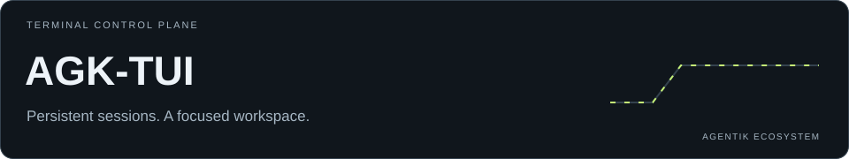
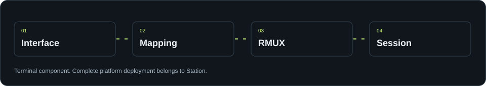

<p align="center"><a href="https://discord.gg/agentik-os"></a></p>

<p align="center"></p>

# AGK-TUI

[Install](#guide-8) · [Product boundary](#guide-1) · [Legacy compatibility distribution](#guide-2) · [The interface at a glance](#guide-3)

> Use the installation section for this terminal component. For a full Discord, Hermes and Portal platform, follow Station. Provider authentication stays in your own environment.

<p align="center"></p>

> **AGK-TUI is the RMUX mapping and terminal-session component of [Station](https://github.com/agentik-os/Station).**
> For a complete Discord + Hermes + AGK-TUI + Portal installation, use Station.

<a id="guide-1"></a>
## Product boundary

AGK-TUI owns the native terminal UI, RMUX session persistence, pane mapping,
provider-terminal launching and session navigation. Complete-VPS concerns —
Hermes fleet deployment, Discord bots and token lifecycle, the private Portal,
provider policy, Operative Systems, global rules, backups, updates and rollback —
are owned by the public [Station repository](https://github.com/agentik-os/Station).

Existing full-stack bootstrap surfaces remain temporarily for compatibility and
migration, but new platform behavior and new installations are developed in
Station. RMUX/TUI bugs are fixed here, then Station advances its immutable
AGK-TUI pin after verification.

AGK-TUI is a native terminal control plane for persistent AI work. It gives
Hermes, Codex, Claude Code, OpenCode, OpenRouter and ordinary shells one
consistent interface while [RMUX](https://github.com/Helvesec/rmux) keeps each
process alive behind it.

The official [NousResearch Hermes Agent](https://github.com/NousResearch/hermes-agent)
is the primary agent runtime. AGK does not replace a provider's terminal UI:
it starts the real provider inside RMUX, displays it in a stable two-panel
workspace, forwards input directly and keeps orchestration metadata separate
from provider state.

In practical terms, you can start work on a VPS from a laptop, disconnect,
reopen AGK from a phone and continue the same live conversation.

<a id="guide-2"></a>
## Legacy compatibility distribution

The historical standalone installer still provisions the following integrated
stack for existing deployments. New installations should use Station, which
owns and tests this composition while consuming AGK-TUI as its RMUX component.

- the native `agk` TUI;
- a verified RMUX client and the required layout integration;
- a durable session registry in `~/.agentik`;
- the official shared Hermes codebase plus profile-local Hermes state;
- adapters for Hermes, Hermes/OpenRouter, Codex, Claude Code and OpenCode;
- Agentik OS packages and specialized catalog agents;
- a profile-local MCP inventory, including redacted Composio connections;
- global Rules synchronized to every supported provider;
- proactive capability routing so agents load matching tools, plugins, skills and
  bounded specialist briefs without waiting for an explicit extension name;
- local bilingual Discord voice transcription with Whisper Large v3 on CPU, plus
  local Piper voice replies (no speech API key required);
- optional Hermes gateways for Discord and headless operation;
- seamless conversation continuation between Discord and AGK;
- a transactional client-organization control plane for Mission work;
- on a VPS, a topology manager for Operator, Agentik, Mission and Private.

Provider credentials are never stored in this repository and are never copied
between profiles.

<a id="guide-3"></a>
## The interface at a glance

AGK has one horizontal menu, one working board and one permanent footer. There
is no decorative terminal background: your real terminal colors remain the
canvas unless you explicitly select a full-canvas theme.

### Desktop layout

```text

  1 SESSIONS  2 PROJECTS  3 AGENTS  4 OS  5 MCP  6 SKILLS  7 RULES  8 SETTINGS
  ───────────────────────────────────────────────────────────────────────────
  ┌─ SESSIONS ─────────────────┐ ┌─ LIVE PROVIDER ──────────────────────────┐
  │ ● mission-research         │ │                                          │
  │   HERMES · mission · 2m    │ │  The real Hermes/Codex/Claude terminal   │
  │                            │ │  fills all available vertical space.      │
  │ ○ agentik-product          │ │                                          │
  │   CODEX · agentik · 1h     │ │  Input stays at the provider's own        │
  │                            │ │  bottom prompt.                           │
  └────────────────────────────┘ └──────────────────────────────────────────┘
  ───────────────────────────────────────────────────────────────────────────
  AGK · mission · research · main     TKN 24.8K · RAM 31% · CPU 8% · DISK 42% · ● 2 LIVE
```

Opening a session does not collapse its left panel. The same session name,
provider, environment, status and activity information stays visible. The
provider pane owns text input as soon as it receives focus; there is no second
confirmation step.

### Phone and narrow-terminal layout

```text

  3 AGENTS  4 OS  5 MCP  6 SKILLS
  ────────────────────────────────
  ┌─ OS REGISTRY ────────────────┐
  │ ● Research OS                │
  │ ● Content OS                 │
  │ ○ Client Operations OS       │
  └──────────────────────────────┘
  ────────────────────────────────
  AGK · mission     TKN 24.8K RAM 31% CPU 8% DISK 42% ● 2 LIVE
```

The top menu always remains one line. On a narrow display it shows a moving
window around the selected item; `←` and `→` still reach every menu. Content
uses one panel at a time, selected with `Tab`. Main-menu numbers remain active
on mobile, while provider creation is intentionally done through `n` and its
arrow-driven picker so number keys never have two meanings.

Any SSH client on iOS or Android can run AGK. Connect to the VPS, run `agk`,
and use portrait or landscape mode as preferred; landscape gives the provider
more columns. A terminal width around 45 columns is enough for the compact
layout. Prefer SSH over a private network or VPN and key-based authentication
instead of exposing password login publicly.

<a id="guide-4"></a>
## How the pieces fit together

```text
                         AGK-TUI
                            │
          ┌─────────────────┼──────────────────┐
          │                 │                  │
     Agentik state       RMUX daemon      Hermes registries
   projects, profiles    live processes   agents, OS, skills,
   rules, sessions       and scrollback   MCP and model usage
          │                 │                  │
          └─────────────────┼──────────────────┘
                            │
          Hermes · Codex · Claude Code · OpenCode · Shell
```

The ownership contract is deliberately simple:

- RMUX owns live terminal processes, pane state and scrollback.
- AGK owns durable orchestration metadata and the unified interface.
- Hermes owns agent behavior, profiles, skills, gateways and MCP loading.
- Each provider owns its own terminal UI, account and conversation format.

Closing AGK never stops the work behind it. Starting `agk` again reconnects to
the current RMUX state and reconciles it with the durable registry.

<a id="guide-5"></a>
## Menus

### 1 Sessions

Sessions are real persistent provider terminals. `Enter` opens the selected
session and focuses its text input immediately. The left list stays visible;
a rapid `Tab Tab` is the only shortcut that intentionally hides it.

Press `n` to create a session, choose a provider with `↑`/`↓`, press `Enter`,
type a canonical name and press `Enter` once. AGK waits until the new RMUX pane
is actually live and then opens it directly.

Supported session kinds are:

- Hermes;
- Codex;
- Claude Code;
- OpenCode;
- Hermes with OpenRouter;
- a normal login shell.

On desktop, `1` through `5` are optional direct provider shortcuts only while
the Sessions content panel owns focus. On compact/mobile layouts, numbers are
reserved exclusively for the main menu.

`x` asks before closing the selected session: `Enter` or `y` confirms, any
other key keeps it running. Closing stops its RMUX process and archives the
AGK record so history remains recoverable. Live RMUX sessions started outside
AGK can be closed the same way; AGK refuses only the unsafe case where the
selected RMUX session is the one currently hosting AGK itself. `r` opens the
rename field.

Every row shows what RMUX reports right now: the provider that is really
running (also for sessions started with plain `rmux`), its working directory,
and whether it is `working`, `running`, `idle` or `exited`.

`agk restart SESSION` reopens the same conversation instead of an empty one,
for every provider:

- Claude Code sessions are created with their own conversation id;
- Hermes sessions are launched on a conversation named after the session
  (`hermes chat --continue NAME --create-if-missing`), so the launch itself
  is what resumes it, whenever the first message is sent;
- Codex and OpenCode cannot be given an id at launch: AGK reads it back from
  the CLI's own store, as the first conversation started in the session's
  directory. Two unlinked sessions of the same provider in one directory are
  ambiguous and are left unlinked rather than resumed on the wrong
  conversation.

`agk fork SESSION NAME` branches Claude Code, Codex and OpenCode conversations
once; the fork then resumes as itself.

### 2 Projects

Projects are detected automatically. Every folder that holds a project
marker (`.git`, `package.json`, `Cargo.toml`, `pyproject.toml`, `go.mod`,
`Package.swift`, `wrangler.toml`, `AGENTS.md`, …) directly inside a projects
folder is listed with its stack and current branch, most recently changed
first. A folder without any marker is treated as a group and its own children
are checked once, so `clients/acme` works; a repository is never descended
into, so a monorepo is one project.

Without configuration AGK looks in the conventional folders that exist
(`~/projects`, `~/workspace/projects`, `~/code`, `~/dev`, `~/src`, `~/repos`,
`~/Developer`). To choose the folders, set them in
`~/.config/agk/environment.yaml`:

```yaml
environment: agentik
projects_root: ~/projects        # also where `/project new` creates folders
project_roots:                   # additional folders to scan
  - ~/ai
```

Sessions are attached to their project by the directory they are really
working in, including sessions started with plain `rmux`. `n` on a project
starts a new session inside it, with a name proposed from the project. `F5`
rescans immediately; `agk projects` prints the same list.

Clients, projects and missions registered in the control registry
(`/project new` in Hermes) are listed first with their relationships, and a
registered project is never listed a second time as a detected one. Selecting
a project also gives the footer the correct Git repository and branch context.

### 3 Agents

Agents lists installed specialized-agent manifests, their Hermes profile,
linked OS packages and durable runtime status. `Enter` opens that agent's
synced conversation list; another `Enter` resumes the selected native Hermes
conversation in RMUX, while `n` starts a dedicated new conversation.
Every agent gets its own workspace under
`~/.agentik/agents/<agent-id>/workspace` and a frozen copy of its installed
instructions.

### Discord and terminal continuity

Hermes' native session ID is the shared conversation identity. From a terminal
chat, `/handoff discord` continues it through the profile bot. From Discord,
open `/panel`, choose **Sessions**, then select any authorized active
conversation. Back in AGK, the same conversation appears under **Sessions** or
under its named profile in **Agents** and resumes with one `Enter`.

The transcript is not duplicated: Discord and AGK reopen the same Hermes
record, protected by Hermes' turn lease. Routine restart notifications are
silent; only a gateway that stays unavailable for ten minutes emits one alert
in the Operator bot's `#general`, with silent recovery. See
[Conversation continuity](docs/SESSION-SYNC.md) for the full security and
operational model.

### 4 OS

An Agentik Operative System is a versioned package of agents, skills,
workflows, tools, commands, knowledge and evaluations. It is not another
Linux operating system.

Each installed OS resolves to a responsible catalog agent. An explicit
versioned agent binding such as `research-os@1.2.0` wins; older packages can
name an agent directly, with the Master OS Builder retained as the lifecycle
fallback. The detail panel shows the resolved owner, Hermes profile and RMUX
session.

Pressing `Enter` on an OS opens a conversation with that responsible agent.
AGK creates or repairs the agent's isolated workspace, validates its profile
and scope, starts/resumes its Hermes session and focuses the chat directly.

### 5 MCP

MCP shows redacted capability identities from the current Hermes profile.
Hermes MCP definitions are parent entries. Composio is another parent entry;
its detail panel lists connected toolkits and connection counts without API
keys, account identifiers or command secrets.

Composio authentication is profile-local. Logging in as `operator` does not
authenticate `mission`:

```bash
sudo -u mission -H /usr/local/bin/agk composio login
sudo -u mission -H /usr/local/bin/agk composio connect github --no-browser
sudo -u mission -H /usr/local/bin/agk composio list
sudo -u mission -H /usr/local/bin/agk composio list github
```

The `connect` command starts login automatically when required. Refresh the
inventory with `agk composio list` or `F5` after changing a connection.

### 6 Skills

Skills combines the installed Hermes (including its category folders),
Claude, Codex and shared `~/.agents/skills` skill identities while
preserving their source. AGK reads identity and status for presentation; the
provider remains responsible for loading and executing the actual skill.

### 7 Rules

Rules is the operator policy registry. The left panel lists each rule and the
right panel shows its full content, enabled state, provider scope and source.
Rules target all supported providers by default and are synchronized into each
provider's native instruction location during installation and updates.

### 8 Settings

Settings contains:

- Appearance: `Auto` (the default) follows the host terminal's real
  background, text color and light/dark mode; built-in dark/light themes, full
  black, full white and custom RGB colors remain available. Selection previews
  live; `Enter` persists and `Esc` reverts. `C` copies the theme on screen into
  Custom and opens the editor; `D` cycles the color depth
  (auto, 24-bit, 256, 16). A light theme on a dark terminal (or the reverse)
  paints its own canvas, and every theme is contrast-checked against the
  background that is really behind it.
- Providers: installed/configured status and foreground install or repair.
- Sessions: persistent split-preview preference.
- Runtime: registry refresh cadence.
- System: per-model token accounting, host metrics and profile health.
- Help: the complete keyboard reference inside the Settings submenu.
- About: the runtime ownership contract and version context.

<a id="guide-6"></a>
## Keyboard model

The navigation has no intermediate menu mode:

| Key | Action |
| --- | --- |
| `←` / `→` | Change the main top menu from any content list |
| `1` … `8` | Open a main menu directly |
| `↑` / `↓` | Select content, or scroll the focused detail |
| `Enter` | Open/activate the selected item |
| `Tab` | Alternate only between left list and right panel |
| rapid `Tab Tab` | Hide the session list and expand the provider |
| `Ctrl-g` | Return from provider input to the Sessions list |
| `n` | New session picker |
| `x` | Close selected session (asks first) |
| `r` | Rename selected session; refresh elsewhere |
| `/` | Search the current registry |
| `Ctrl-p` | Command palette |
| `Ctrl-r` | Reload AGK from Control mode |
| `F5` | Refresh registries and live state |
| `PgUp` / `PgDn` | Browse RMUX history in a focused session pane |
| `Home` / `End`, `g` / `G` | Oldest available history / live tail |
| wheel in the pane | Scroll history; in a full-screen program, scroll that program |
| `q` `q` | Leave AGK (asks first); provider sessions continue in RMUX |
| drag in the pane | Select text; releasing copies it to the clipboard |
| double-click in the pane | Copy the word, path or URL under the pointer |
| `Shift-Enter` | New line in the provider prompt without sending |

When the provider pane has focus, ordinary text, cursor, editing and provider
shortcuts go directly to that real terminal. When the session list has focus,
`n`, `x`, `r`, `q` and `Ctrl-r` remain AGK controls instead of being swallowed
by terminal forwarding. Mouse click and wheel focus/scroll the panel under the
pointer.

Copy and paste behave like a normal terminal even though AGK mirrors the pane:

- dragging inside the pane selects text and releasing copies it; a
  double-click copies one word, path or URL;
- anything a provider copies itself (OSC 52, RMUX copy-mode) is relayed to the
  real clipboard within a second;
- copies use the local clipboard program (`pbcopy`, `wl-copy`, `xclip`) and
  the OSC 52 escape, which also reaches your own computer over SSH;
- pastes go through RMUX's paste path, so a program that enabled bracketed
  paste receives one atomic paste while a plain shell receives the text
  itself. Long prompts are not truncated; a provider may summarize them as
  `[Pasted Content 13090 chars]` while still submitting the complete text.

A program that takes over the whole screen (OpenCode, Codex, a pager, an
editor) has no RMUX history. There the wheel, `PgUp`/`PgDn` and `Home`/`End`
go to the program itself: as mouse reports when it asked for the mouse, as
arrow keys otherwise.

`Shift-Enter` (and `Alt-Enter`) sends `Ctrl-J`, the one "new line without
sending" key that Hermes, Claude Code, Codex and OpenCode all accept; in a
plain shell it continues the command line with a backslash. `Shift-Enter` and
`Ctrl-Space` need a terminal with the kitty keyboard protocol (Ghostty, kitty,
WezTerm, foot); AGK enables it automatically. Terminals without it, such as
Terminal.app, cannot tell `Shift-Enter` from `Enter`: use `Alt-Enter` there
(enable "Use Option as Meta key") or type `Ctrl-J` directly.

Over SSH only your own terminal can reach your clipboard, through OSC 52, and
it does not confirm; AGK then says the text was *sent* to the terminal.
Terminal.app does not implement OSC 52, so copying from a remote AGK needs
iTerm2, Ghostty, kitty or WezTerm on your side.

<a id="guide-7"></a>
## Footer and resource information

The footer stays visible in Control mode, split session mode and expanded
session mode. It uses one line and adapts the amount of context to the terminal
width:

```text
AGK · profile · session · project · branch   MODEL · TKN · RAM · CPU · DISK · LIVE
```

`TKN` is authoritative input plus output usage attributed to the selected
Hermes session/model. Settings > System keeps model/provider rows separate and
also shows cache reads/writes, reasoning tokens and API-call counts. AGK shows
`—` when it cannot link a provider session to authoritative usage; it never
invents a token count.

<a id="guide-8"></a>
## Install

### Fresh Debian or Ubuntu VPS

Run the complete bootstrap:

```bash
curl --proto '=https' --tlsv1.2 -fsSL \
  https://raw.githubusercontent.com/agentik-os/AGK-TUI/main/install | sudo bash
```

Inspect the plan first without changing the host:

```bash
curl --proto '=https' --tlsv1.2 -fsSL \
  https://raw.githubusercontent.com/agentik-os/AGK-TUI/main/install | bash -s -- --dry-run
```

Add `--core-only` after `bash -s --` to omit optional Claude Code, Codex and
OpenCode binaries. Pin a release, tag or commit with `--ref REF` when you need
a reproducible installation.

The equivalent local workflow is:

```bash
git clone https://github.com/agentik-os/AGK-TUI.git
cd AGK-TUI
sudo ./bootstrap-vps.sh --dry-run
sudo ./bootstrap-vps.sh
```

The VPS bootstrap installs prerequisites, Rust, RMUX, AGK-TUI, the one shared
official Hermes checkout, Composio per profile, optional providers, canonical
workspaces and the TopologyManager timer. Existing users and their files are
preserved. A verified RMUX client is installed before AGK starts, preventing a
stale client from talking an incompatible wire protocol to the daemon.

### macOS

Run the installer as your normal user, without `sudo`:

```bash
curl --proto '=https' --tlsv1.2 -fsSL \
  https://raw.githubusercontent.com/agentik-os/AGK-TUI/main/install | bash
```

Apple Silicon and Intel are supported. The macOS bootstrap is single-user,
installs into `~/.local`, verifies the RMUX archive checksum, creates a private
Python runtime with `uv`, builds the native Rust TUI and installs provider
binaries without logging into their accounts. Apple Command Line Tools are the
only host prerequisite.

After installation, open a new Terminal. If an existing shell has not picked
up the launcher yet:

```bash
export PATH="$HOME/.local/bin:$PATH"
exec "$SHELL" -l
agk doctor
agk
```

Use `--core-only` to omit optional providers, or run
`./bootstrap-macos.sh` from a clone. The bootstrap can be run again at any
time to update an installation; `agk --version` shows the installed commit.

### Existing Linux profile

```bash
git clone https://github.com/agentik-os/AGK-TUI.git
cd AGK-TUI
./install.sh
```

For a shared Linux binary installation owned at runtime by one non-root
identity:

```bash
sudo ./install.sh --system --user "$USER"
```

### After installation

Authenticate only the profiles that need a service:

```bash
sudo -u mission -H hermes portal
sudo -u mission -H agk composio connect github --no-browser
sudo -u mission -H agk provider install claude
sudo -u mission -H agk provider install codex
```

Use `config/hermes.env.example` as the non-secret gateway checklist. Install a
Hermes gateway only after its Discord token and policy are configured:

```bash
sudo -u mission -H agk hermes gateway install --force --start-now
```

`agentik-os.com` is a public Agentik availability endpoint, not a Hermes login
service. Hermes account and Tool Gateway authentication remain on Nous Portal,
independently for every profile.

<a id="guide-9"></a>
## Multi-user VPS architecture

A full VPS keeps four Linux security boundaries behind one product model:

```text
profile_id       TopologyManager       Linux boundary       Runtime
operator   ───▶  operator       ───▶  /home/operator  ───▶ Hermes + RMUX
agentik    ───▶  agentik        ───▶  /home/agentik   ───▶ Hermes + RMUX
mission    ───▶  mission        ───▶  /home/mission   ───▶ Hermes + RMUX
private    ───▶  private        ───▶  /home/private   ───▶ Hermes + RMUX
```

The product uses `profile_id`; only TopologyManager maps it to a Linux user.
Discord/gateway bindings also target a profile ID rather than hard-coding a
username. This gives one control-plane experience without sharing credentials,
Hermes state, Composio sessions or RMUX sockets between profiles.

Canonical workspaces are:

```text
/home/operator/workspace/  infrastructure security deployments monitoring automation deposit docs
/home/agentik/workspace/   projects products missions research content growth community knowledge artifacts
/home/mission/workspace/   clients/<client>/{projects,missions,knowledge,artifacts,infrastructure,automation}
/home/private/workspace/   projects journal goals learning research knowledge artifacts
```

One official Hermes codebase is shared at `/opt/agentik/hermes/current`.
Runtime state is not shared: every profile keeps its own `~/.hermes`, RMUX
daemon/socket, sessions, plugins, MCP credentials and gateway configuration.

Useful topology commands:

```bash
agk topology detect
agk topology status
sudo agk topology apply --yes
```

Mission client runtimes can still be local, containerized, remote or external;
that client topology is deliberately separate from the profile topology.

<a id="guide-10"></a>
## Client organizations and CTO gates

Each Mission client is an isolated product organization, not just a folder or
an agent prompt. Linear owns the work, GitHub owns code and CI evidence, Figma
owns design, Hermes owns resumable execution, Discord carries human decisions,
and AGK enforces the workflow and audit trail.

```text
Linear issue -> AGK work -> same Hermes session -> branch / PR
             -> CI + QA + security -> staging -> CTO engineering approval
             -> separate production authorization -> AGK Run -> health check
             -> Linear done
```

Installation initializes the standard and an empty registry. It never creates
a client or a remote resource by itself. A safe onboarding sequence is:

```bash
sudo -u mission -H agk client bootstrap --upgrade
sudo -u mission -H agk client init foued --name "Foued Legal AI" \
  --runtime hybrid --github-mode org --github-org foued \
  --linear-workspace WORKSPACE_ID --linear-team TEAM_ID \
  --discord-guild GUILD_ID --dry-run
sudo -u mission -H agk client init foued --name "Foued Legal AI" \
  --runtime hybrid --github-mode org --github-org foued \
  --linear-workspace WORKSPACE_ID --linear-team TEAM_ID \
  --discord-guild GUILD_ID
sudo -u mission -H agk client integrations plan foued
```

Connect a distinct Composio account selector for every enabled client
integration; AGK never falls back to a profile-wide default account:

```bash
sudo -u mission -H agk composio connect linear \
  --alias client-foued-linear --no-browser
sudo -u mission -H agk composio connect github \
  --alias client-foued-github --no-browser
sudo -u mission -H agk composio connect discordbot \
  --alias client-foued-discordbot --no-browser
sudo -u mission -H agk client integrations verify foued
sudo -u mission -H agk client discord plan foued
# Only after reviewing the plan:
sudo -u mission -H agk client discord apply foued --yes
sudo -u mission -H agk client activate foued --yes
# Run the `next_command` printed by activate to configure this isolated profile.
sudo -u mission -H agk client doctor foued --online
```

After mapping the client's Linear workflow-state IDs in
`.client/integrations.yaml`, `agk client linear plan/apply` synchronizes an AGK
work record and its idempotent journal comment. `agk client discord
review-plan/review-apply` delivers the governed CTO card to the provisioned
client channel.

`agk client init` is local and transactional. Discord provisioning is a
separate, explicit, idempotent apply with rollback of resources created by a
failed attempt. Client credentials live outside the workspace at
`~/.config/agk/clients/<client>/env` with mode `0600`. The exact workflow,
commands, policies and recovery behavior are documented in
[Client organizations](docs/CLIENT-ORGANIZATIONS.md).

<a id="guide-11"></a>
## Commands

```bash
agk                              # open the native TUI
agk status                       # concise runtime status
agk doctor                       # local readiness report
agk sessions                     # durable session registry
agk new hermes research-chat     # create a named provider session
agk new claude fix-login --cwd ~/projects/app --project app
agk new hermes local --model local-gpt   # model id or alias for that provider
agk projects                     # registered and detected projects
agk --version                    # installed commit and location
agk specialist start AGENT_ID    # start/resume a catalog agent conversation
agk open SESSION                 # attach from the CLI
agk close SESSION --yes          # stop and archive
agk purge SESSION --yes          # stop and delete AGK metadata permanently
agk provider list
agk provider verify
agk provider install claude
agk mcp
agk composio list
agk rules
agk hermes sync --all             # extensions + rules in every Hermes profile
agk hermes update                 # latest official Hermes, then sync --all
agk topology status
agk client list
agk client doctor CLIENT --online
agk client work create CLIENT --issue FOU-142 --title "Feature" \
  --role backend-engineer --repo ORG/REPO
```

`agk purge` is intentionally different from `x`: purge permanently removes the
selected AGK registry record after stopping RMUX. Normal close keeps the
archived metadata.

To reinstall/update official shared Hermes, with a timestamped recovery
snapshot before launcher or service changes:

```bash
sudo agk-terminal hermes install-shared
```

<a id="guide-12"></a>
## State and security boundaries

| Path | Owner | Purpose |
| --- | --- | --- |
| `~/.agentik/runtime.db` | current profile | durable AGK sessions/events |
| `~/.agentik/control.db` | current profile | projects and mission objects |
| `~/.agentik/agents/` | current profile | isolated specialist workspaces |
| `~/.agentik/rules.yaml` | current profile | optional profile rule override |
| `~/workspace/clients/` | Mission profile | isolated client workspaces and audit records |
| `~/.config/agk/clients/` | Mission profile | client-local non-Composio secrets, mode `0600` |
| `~/.hermes/` | current profile | Hermes config, state, skills and profiles |
| `~/.composio/` | current profile | Composio authentication |
| `~/.claude/`, `~/.codex/` | current profile | provider-local state |
| `~/.config/opencode/` | current profile | OpenCode configuration |
| `/etc/agk-terminal/` | root | system topology and non-secret defaults |
| `/opt/agentik/hermes/current` | root/shared | official Hermes code symlink |

The TUI reads redacted capability and health data. It does not display MCP
headers, environment secrets, provider tokens or Composio account identifiers.

<a id="guide-13"></a>
## Troubleshooting

AGK recovers on its own from a dropped RMUX connection and the `agk` launcher
reopens the interface after an unexpected exit; sessions are never affected.
Recoveries and crashes are recorded in `~/.agentik/logs/agk-tui.log`.

Start with:

```bash
command -v agk
command -v rmux
agk doctor
agk provider verify
agk topology status
```

If `agk` is not found after a macOS/user installation, add
`$HOME/.local/bin` to `PATH` and start a new login shell as shown above.

If RMUX reports an unsupported wire version, an old client is still earlier in
`PATH` or an old daemon is still active. Re-run the current AGK installer; it
performs a real `list-sessions` protocol check, preserves an incompatible
user-local executable as `.agk-incompatible`, and exposes the verified client.
Then confirm `command -v rmux` and `rmux -V` in the same login shell.

If a provider appears installed but a session exits immediately, run:

```bash
agk provider verify
agk doctor
agk info SESSION
rmux capture-pane -p -t SESSION -S -200
```

If Composio says one user is logged in but another is not, authenticate as the
same Linux profile that runs AGK. This is expected isolation, not shared global
login state.

If `x` or `n` appears inactive, make sure the session list owns focus (`Tab`).
In current releases those keys are explicitly routed to AGK from the visible
sidebar even while the right provider pane is live.

<a id="guide-14"></a>
## Development

The important repository surfaces are:

```text
apps/agk-tui/       native Rust interface and RMUX SDK integration
client/             client organization templates, workflow and policies
scripts/            session, provider, topology and synchronization logic
bin/                public agk and agk-terminal launchers
hermes/             AGK plugins, dashboard assets and catalog agents
config/             non-secret topology, providers and Rules defaults
tests/              orchestration, installation and security contracts
docs/               deeper architecture and Hermes runtime documentation
```

Run the complete quality gate:

```bash
./scripts/test.sh
```

The gate checks Rust formatting and Clippy, runs native and Python tests,
validates shell scripts, then tests and builds the optional fleet dashboard.

<a id="guide-15"></a>
## Design contract

AGK-specific behavior is delivered as plugins, catalog assets and adapters;
the official Hermes core remains replaceable and updateable. Installations and
topology refreshes preserve existing user homes. The registry never fabricates
OS packages, model usage or provider readiness when no authoritative source
exists; a project is listed only when the control registry or a marker file
on disk says the folder is one.

For deeper implementation detail, read
[Architecture](docs/ARCHITECTURE.md) and
[shared Hermes runtime](docs/HERMES.md).

---

**Community and licensing** · [Discord](https://discord.gg/agentik-os) · [LICENSE](LICENSE)

Illustrative visuals, not live telemetry. Service access and secrets belong to each installation.
